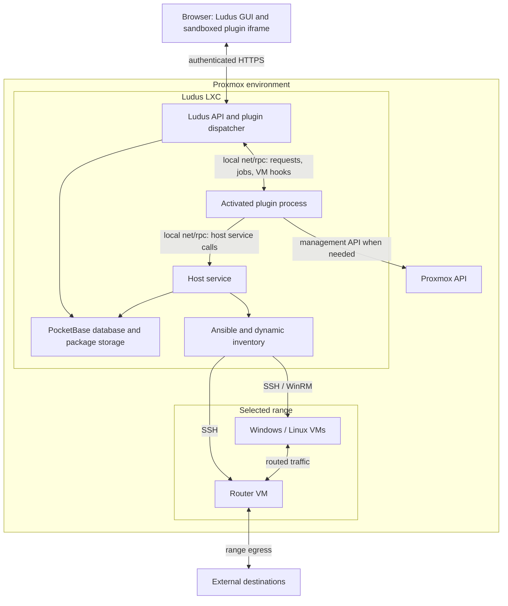

# 🔌 Plugins

Plugins add features to Ludus, such as range diagnostics, traffic monitoring, or custom tools in the web UI. A plugin can include a server component, a web interface, or both.

## What plugins can do

Plugins can:

- Add a page under **Resources → Plugins** in the web UI.
- Read range information and provide actions for the selected range.
- Run Ansible playbooks to install or configure software on range machines.
- Run scheduled jobs.
- Add actions that users can run from the plugin's web interface or through the API.

System-level plugins can also add top-level API routes and customize how Ludus selects, starts, stops, and deletes VMs (VM lifecycle hooks). See [Levels and run-as users](#levels-and-run-as-users).

## How plugins work

A plugin's server component is a Go program built with the [Ludus plugin SDK](#writing-a-plugin) into a Linux executable. It runs as a separate process on the Ludus server. Ludus forwards requests to it over local RPC (`net/rpc` over `hashicorp/go-plugin`).

Plugins never open the Ludus database or read `config.yml`. Ludus passes each request with the caller, user, and range already resolved, and the plugin calls back into the Ludus **host service** for anything else: range VMs, range files, log history, playbook runs, Proxmox credentials, quotas, and license state. The host service applies the caller's permissions and the plugin's declared level to every call.

If a plugin has a web interface, it opens inside Ludus. Ludus provides the selected range and handles authenticated requests between that interface and the plugin's server component.

In an LXC installation, the plugin process runs inside the Ludus container. Range VMs run alongside that container on Proxmox. Playbooks a plugin runs through the host service are executed by Ludus, which archives each run in the range's log history.



## Installing a plugin

1. Open **Resources → Plugins** in the web UI.
2. Upload the plugin's ZIP package. Any user can upload.
3. An administrator reviews the declarations and selects **Activate**.

Before activation, the plugins page shows what the administrator is approving, read from `plugin.json` without running anything:

- level and run-as user
- `forwardCallerCredentials`
- top-level API routes
- VM hook capabilities
- author, version, and package SHA-256

The activation request carries the SHA-256, level, and run-as user the administrator saw. Ludus rejects it if the stored package differs, so a replacement uploaded between review and approval cannot be activated by mistake. Replacement uploads always need approval again.

Activated plugins load again when Ludus restarts. If a plugin crashes, select **Activate** to start it again.

:::warning
Only activate plugins from authors you trust. A plugin process runs as the `ludus` service account or as root, and can do anything that account can do on the Ludus server.
:::

## Levels and run-as users

Every plugin declares a level and a run-as user. They are independent: the level grants Ludus capabilities, the run-as user grants OS privileges.

| Capability | `standard` | `system` |
|---|---|---|
| Routes under `/api/v2/plugins/{id}/rpc/` | Yes | Yes |
| Top-level routes under `/api/v2/` | No | Yes |
| Caller-scoped host methods while handling a request | Yes | Yes |
| Service host methods from `Init`, jobs, and VM hooks | `License` only | Yes |
| Service host methods while handling a request from an admin | No | Yes |
| VM lifecycle hooks (the plugin must also run as `root`) | No | Yes |
| Playbooks from the plugin's state directory | Yes | Yes |
| `ludus.InstallFiles` and playbooks from `ansible/range-management` | No | Yes |

| | `ludus` | `root` |
|---|---|---|
| Process user | `ludus` | `root` |
| Hosted by | `ludus.service` | `ludus-admin.service` |
| Executable runs from | The package store | A root-owned copy under `/opt/ludus/plugins/` only |

A `standard` plugin running as root still gets only caller-scoped host methods. A `system` plugin running as `ludus` still has only `ludus` file permissions. Requests to root-run plugins and their routes still go through `ludus.service`, which proxies them to the admin service.

Each plugin runs in exactly one service. A plugin with VM hooks must run as `root`, because hook-driven power and delete operations run in the admin service; `ludus.service` asks the admin service which hooks apply. A top-level API route that another active plugin already claims, in either service, keeps the later plugin from starting.

Ludus refuses to start a plugin whose runtime metadata disagrees with its `plugin.json`, and always uses the approved `plugin.json` declarations.

### Root-run plugins

`ludus-admin.service` starts a root-run plugin only from root-owned storage. When an administrator activates an uploaded root-run package, the admin service copies it to `/opt/ludus/plugins/uploaded/<resource ID>/` and writes a root-owned `approval.json` recording the executable's SHA-256, level, and run-as user. Before every start it checks that each directory from `/opt/ludus/plugins` down to the executable is owned by root and not group- or world-writable, and, for uploaded packages, that the executable still matches `approval.json`. Database state alone never starts a root-run plugin.

### Caller credentials

Ludus removes the `Authorization`, `X-API-KEY`, and `Cookie` headers before forwarding a request to a plugin. Plugins receive the authenticated caller, effective user, and range already resolved, so most never need the credentials. A plugin that must call the Ludus API as the signed-in user declares `forwardCallerCredentials: true`; administrators see the flag before approving.

### Body size limit

Request and response bodies are limited to 256 MiB (`protocol.MaxBodyBytes`). Larger requests get `413` without reaching the plugin. A response over the limit is replaced with an error status, never a truncated body.

## Writing a plugin

Plugins use the Go module `gitlab.com/badsectorlabs/ludus/ludus-plugin-sdk`. It depends only on `hashicorp/go-plugin` and the standard library; plugins do not import Ludus server code and build as ordinary Go modules.

```go
package main

import (
	"net/http"

	"gitlab.com/badsectorlabs/ludus/ludus-plugin-sdk"
)

var VersionString = "0.0.0-dev"

func main() {
	ludus.Serve(&ludus.Plugin{
		ID:          "hello-ranges",
		Name:        "Hello Ranges",
		Version:     VersionString,
		Description: "Lists the ranges the caller can access",
		Author:      "Example",
		UI:          &ludus.UI{},
		Routes: []ludus.Route{{
			Name:    "ranges",
			Method:  http.MethodGet,
			Pattern: "/ranges",
			Handler: func(w http.ResponseWriter, r *http.Request) {
				c := ludus.CallFrom(r)
				ranges, err := c.Host.AccessibleRanges()
				if err != nil {
					ludus.HostError(w, err)
					return
				}
				ludus.JSON(w, http.StatusOK, ranges)
			},
		}},
	})
}
```

`ludus.Plugin` declares everything that ends up in `plugin.json`: identity, `Level` (`ludus.Standard` by default, or `ludus.System`), `RunAs` (`ludus.RunAsLudus` by default, or `ludus.RunAsRoot`), `ForwardCallerCredentials`, `UI`, `Routes`, and `VMHooks`. It also holds the optional `Init`, `Jobs`, `VMHook`, and `Shutdown` callbacks.

- **Routes** are exact paths. The default scope serves them under `/api/v2/plugins/{id}/rpc/<pattern>`; `Scope: ludus.APIScope` (system level only) serves them under `/api/v2/<pattern>`. API-scoped routes must not start with `/plugins` and are rejected if a core route or another active plugin already uses the method and path. Like core routes, API-scoped routes are open to every authenticated user, so the handler must authorize the caller; plugin sharing settings apply only to plugin-scoped routes and the UI.
- **`ludus.CallFrom(r)`** returns the call: the authenticated principal (`Auth`), the effective user, the selected range, the plugin environment, and a `Host` client bound to this request. `c.IsAdmin()` reports whether the caller is an administrator.
- **Host methods** return `ludus.ErrNotFound`, `ErrForbidden`, `ErrInvalid`, `ErrExpired`, or `ErrUnavailable` (use `errors.Is`). `ludus.HostError` maps them to HTTP status codes.
- **`Init(c, env)`** runs once at start with the plugin principal. `env.StateDir` is a private directory for the plugin's data and playbooks.
- **Jobs** run on the Ludus scheduler at their `Interval` (at least one second), with the plugin principal.
- **`c.Host.RunPlaybook`** runs a playbook as the caller against the selected range, from the plugin's state directory or (system level) `ansible/range-management`. Ludus archives every run, including failures, in the range log history.
- Helpers: `ludus.JSON`, `ludus.Error`, `ludus.Result`, `ludus.DecodeJSON`, `ludus.InstallFiles` (system level), `ludus.APIClient`, and `ludus.Logger`.

The `ludustest` package provides a fake host and a harness that runs a plugin in-process over a real RPC connection, for unit tests of handlers, jobs, and `Init`.

### Building a package

Running the executable with `--ludus-manifest` prints its `plugin.json` and exits, so the manifest always matches the code:

```shell
mkdir -p package/ui
CGO_ENABLED=0 GOOS=linux GOARCH=amd64 go build -trimpath -ldflags "-s -w" -o package/plugin .
./package/plugin --ludus-manifest > package/plugin.json   # run on a linux/amd64 host
cp ui/index.html package/ui/index.html                    # if the plugin has a UI
(cd package && zip -X ../hello-ranges.zip plugin.json plugin ui/index.html)
```

## Package format

Every plugin, uploaded or installed on the server, is a package with these files:

```text
plugin.json
plugin           # optional compiled executable for the server's OS/architecture
ui/index.html    # optional, self-contained HTML with inline JS/CSS
```

The ZIP contains exactly the files declared in `plugin.json`, at its root. Do not include a containing folder, directory entries, symlinks, or other files. At least one of `plugin` or `ui/index.html` is required. The ZIP must be no larger than 128 MiB.

`plugin.json` fields:

| Field | Description |
|---|---|
| `schemaVersion` | Manifest schema version (required). |
| `protocolVersion` | Ludus plugin protocol version; required with `executable`. |
| `id` | Plugin ID (required). |
| `name`, `version` | Required. |
| `description`, `author` | Shown on the plugins page. |
| `level` | `standard` (default) or `system`. |
| `runAs` | `ludus` (default) or `root`. |
| `executable` | `plugin` if the package has a server component. |
| `ui` | `ui/index.html` if the package has a web interface. |
| `rangeScoped` | The web interface works on the selected range. |
| `forwardCallerCredentials` | Keep `Authorization`, `X-API-KEY`, and `Cookie` on forwarded requests. |
| `routes` | `[{"name", "method", "pattern", "scope"}]`; `scope` is `plugin` (default) or `api` (system level only). |
| `vmHooks` | VM hook capabilities: `select`, `start`, `stop`, `status`, `beforeDelete`, `address` (system level only). |

Generate the file with `--ludus-manifest` rather than writing it by hand.

### Server-installed packages

Packages can also be installed directly on the server as `/opt/ludus/plugins/<id>/` (`plugin.json`, `plugin`, optional `ui/index.html`). `/opt/ludus/plugins` and everything under it must be owned by `root:root` and not group- or world-writable. Both services scan `/opt/ludus/plugins/*/plugin.json` at startup and start the packages whose `runAs` matches their own user. Packages placed by root, and licensed packages installed by Ludus after signature verification, count as approved and show the same declarations on the plugins page.

## Sharing plugins

Plugins you upload are private by default. You can share them with specific Ludus users. Administrators can install a plugin for all users and manage any installed plugin.

Sharing a plugin does not grant access to your ranges. Each user still needs access to the range they want to use it with. Sharing controls the plugin's page and its `/api/v2/plugins/{id}/rpc/` routes; a system plugin's top-level API routes are available to every signed-in user, and the plugin checks who may use them.

## Updating and deleting plugins

To update an uploaded plugin, upload the new package and select **Replace existing version**. This keeps its owner and sharing settings. An administrator must activate the new version before it runs.

**Remove** hides a shared plugin from your list without affecting other users. Use **Show plugins available to add back** to restore it to your list.

**Delete** stops an uploaded plugin and removes its package, including any root-owned copy. It does not stop services the plugin installed on range machines, undo machine changes, or remove data it created separately. Run the plugin's cleanup steps before deleting it.

## Troubleshooting

If activation fails, check the error shown for the plugin and the Ludus service logs (`ludus.service` for `runAs: ludus`, `ludus-admin.service` for `runAs: root`). Common causes include an executable built for the wrong architecture, an incompatible plugin protocol version, metadata that does not match `plugin.json`, a top-level route that conflicts with an existing route, or a root-run package in storage that is not root-owned.

If a plugin fails while configuring range machines, check the selected range's Ansible logs and log history for connection errors and failed tasks.
